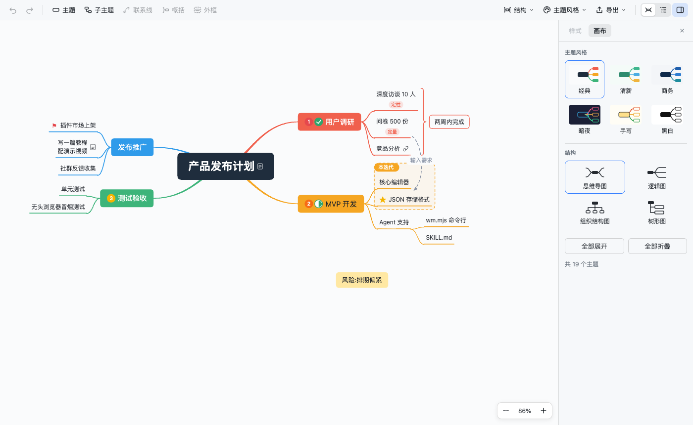
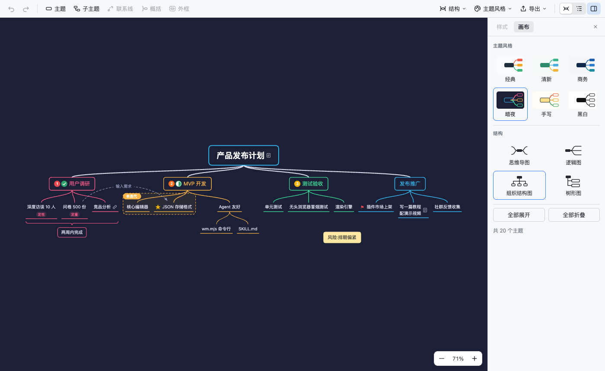

<p align="center">
  
</p>

<h1 align="center">Weilanx Mind Map</h1>

<p align="center"><a href="./README.md">English</a> | 中文</p>

在 VS Code 里使用的 XMind 风格思维导图。每张导图是一个 `.wmind` 文件，内容就是普通 JSON：人在画布上编辑，AI Agent 直接读写文件，两边的改动会实时同步。



## 特性

- **XMind 风格**：彩虹分支、由粗变细的曲线、圆角主题框和下划线子主题；内置 6 套主题（经典、清新、商务、暗夜、手写、黑白），会跟随 VS Code 的亮色 / 暗色自动切换。
- **4 种结构**：思维导图、逻辑图、组织结构图、树形图，既可以整张图统一设置，也可以只设置某个分支。
- **核心编辑**：增删节点、拖拽改层级和顺序、折叠展开、多选、框选、撤销重做、复制粘贴子树（也可以直接粘贴 Markdown 或缩进文本）。
- **样式**：形状、填充、边框、文字（字号、粗体、斜体、删除线、颜色）、分支线（颜色、粗细、曲线 / 直线 / 折线），支持多选后批量修改。
- **内容**：标记（优先级、任务进度、旗帜、星星、表情、符号）、标签、备注、超链接（网页地址或工作区里的相对路径）。
- **高级元素**：联系线（可以拖动控制点调整弧度、可以加文字）、概括、外框、自由主题。
- **大纲视图**：把整张图当成可编辑的缩进列表来写。
- **导入导出**：导出 PNG（2 倍清晰度）、SVG、Markdown 大纲；也可以从 Markdown 大纲生成导图。
- **对 Agent 友好**：嵌套树结构的 JSON、固定的键顺序、只写非默认值，git diff 很干净；另外配了 skill 和零依赖命令行 `wm.mjs`。



## 快速上手

1. 安装 `weilanx-mind-map.vsix`：VS Code 命令面板 → `Extensions: Install from VSIX...`。
2. 在资源管理器里右键文件夹 → **新建思维导图**；也可以直接打开任意 `.wmind` 文件。
3. 想看或手改 JSON 时，点编辑器右上角的 **以 JSON 文本打开**（文本模式下自带 JSON Schema 补全和校验）。

### 快捷键

| 操作 | 按键 |
|---|---|
| 添加同级 / 子级 / 上级主题 | `Enter` / `Tab` / `Shift+Tab` |
| 在前面插入同级主题 | `Shift+Enter` |
| 编辑文字 | `Space`、`F2`、双击，或者选中后直接打字（支持中文输入法） |
| 编辑时换行 / 结束编辑 | `Shift+Enter` / `Enter` 或 `Esc` |
| 删除 | `Delete` / `Backspace` |
| 在主题间移动 | 方向键 |
| 和兄弟主题交换位置 | `⌘↑` / `⌘↓` |
| 折叠 / 展开 | `⌘/` 或点击分支末端的圆点 |
| 撤销 / 重做 | `⌘Z` / `⌘⇧Z` |
| 放大 / 缩小 / 适应画布 | `⌘=` / `⌘-` / `⌘0` |
| 平移 | 拖动空白处、按住空格拖动、触控板双指滑动 |
| 缩放 | `⌘` + 滚轮、触控板捏合 |
| 多选 / 框选 | `⌘` + 点击 / `Shift` + 拖动 |
| 新建自由主题 | 双击空白处 |
| 导出 PNG | `⌘⇧E` |

Windows / Linux 上把 `⌘` 换成 `Ctrl`。

## 文件格式

```json
{
  "version": 1,
  "theme": "fresh",
  "root": {
    "id": "a1b2c3",
    "text": "产品规划",
    "children": [
      {
        "id": "k9x2m1",
        "text": "用户调研",
        "markers": ["priority-1"],
        "summaries": [{ "id": "s1", "from": "p0q9w8", "to": "p0q9w9", "text": "两周完成" }],
        "children": [
          { "id": "p0q9w8", "text": "访谈 10 人", "labels": ["定性"] },
          { "id": "p0q9w9", "text": "问卷 500 份", "note": "Markdown 备注" }
        ]
      },
      { "id": "z7y6x5", "text": "MVP", "style": { "fill": "#FFE8A3" } }
    ]
  },
  "relationships": [{ "id": "r1", "from": "k9x2m1", "to": "z7y6x5", "text": "输入需求" }]
}
```

- 嵌套树结构，读一遍就能看懂整张图。
- 只写和默认值不同的字段：不写 `style` 就表示跟随主题。
- 新节点可以不写 `id`，插件打开时会自动补上。
- 概括和外框用首尾子节点的 id 表示范围，插入兄弟节点后范围不会错位。
- 键顺序和缩进固定，插件、`wm.mjs`、手改的结果格式完全一致。

完整字段说明见 [skills/weilanx-mind-map/references/format.md](./skills/weilanx-mind-map/references/format.md)，JSON Schema 在 [schema/wmind.schema.json](./schema/wmind.schema.json)。

## 给 Agent 用

把 `skills/weilanx-mind-map` 复制到 Agent 的 skills 目录（比如 `~/.claude/skills/`）。Agent 会通过 `wm.mjs` 读写导图：

```bash
WM="node skills/weilanx-mind-map/scripts/wm.mjs"
$WM outline 产品规划.wmind --ids                     # 缩进大纲，最省 token
$WM add 产品规划.wmind --parent "产品规划/MVP" "导出功能" "导入功能"
$WM set 产品规划.wmind "产品规划/MVP/导出功能" --marker priority-1 --style fill=#FFE8A3
$WM from-md 周会.md -o 周会.wmind
$WM validate 产品规划.wmind
```

节点可以用 id 定位，也可以用从中心主题开始的路径定位（例如 `产品规划/MVP`）。如果插件开着这个文件，画布会立即刷新。

## 开发

```bash
npm install
npm run dev:web     # 浏览器里预览画布（用 localStorage 模拟文件）
npm test            # core 单元测试 + wm.mjs 集成测试
npm run typecheck
npm run package     # 构建并打包 weilanx-mind-map.vsix
```

目录结构：`src/core`（格式、编辑操作、主题、布局，纯 TS）· `src/vscode`（自定义编辑器）· `webview`（React 画布）· `src/cli`（`wm.mjs`）。

## 许可

MIT
