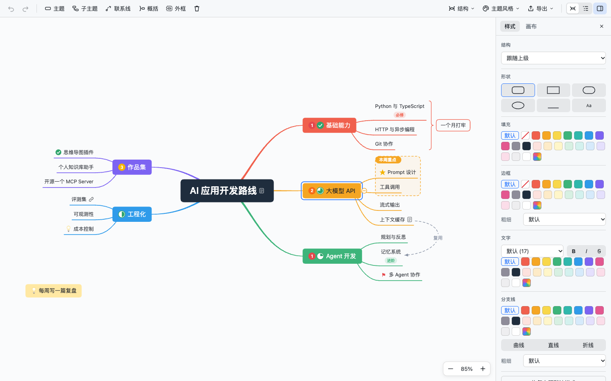
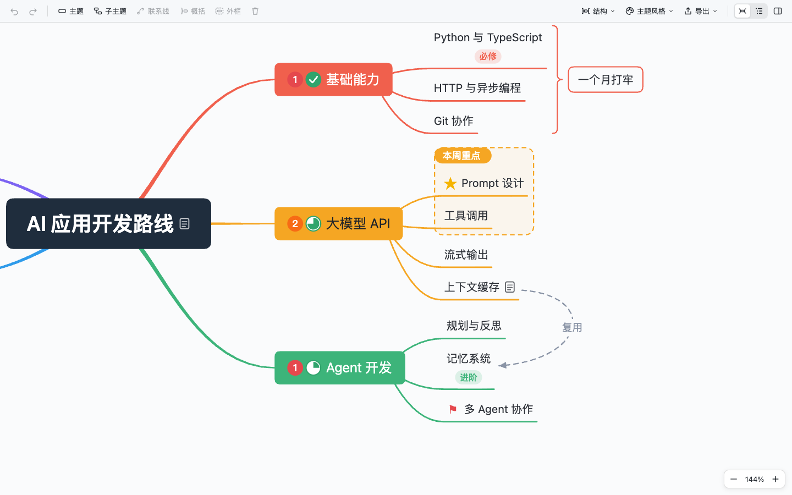
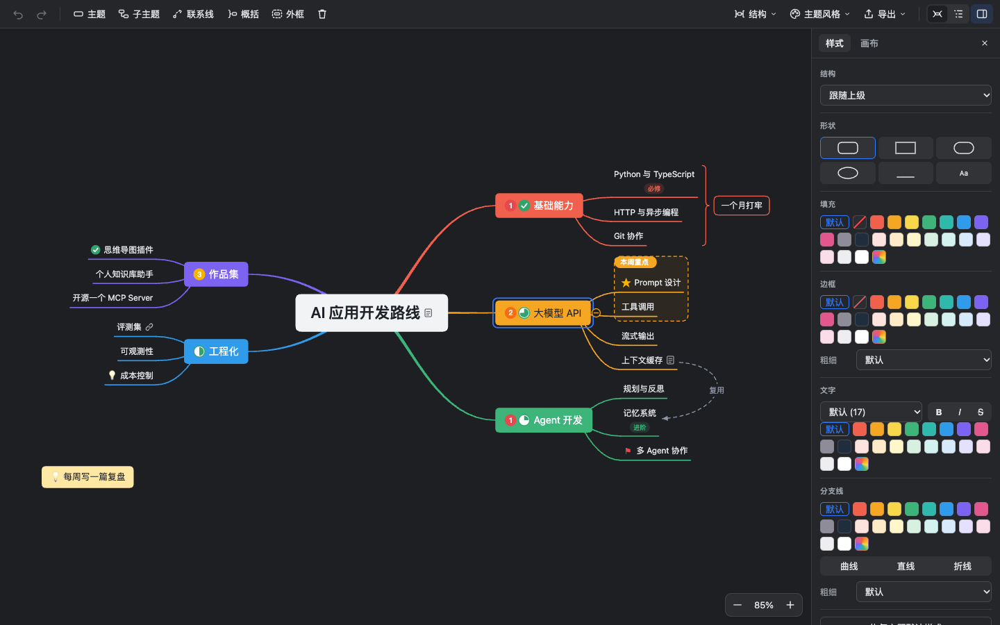
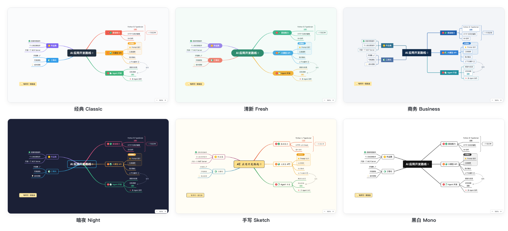
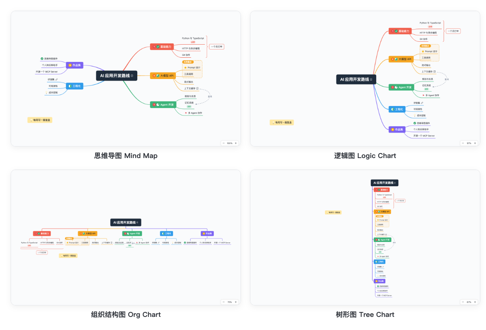
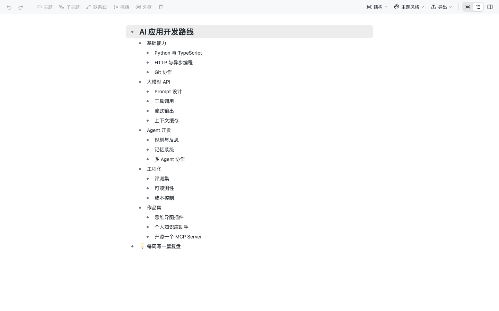
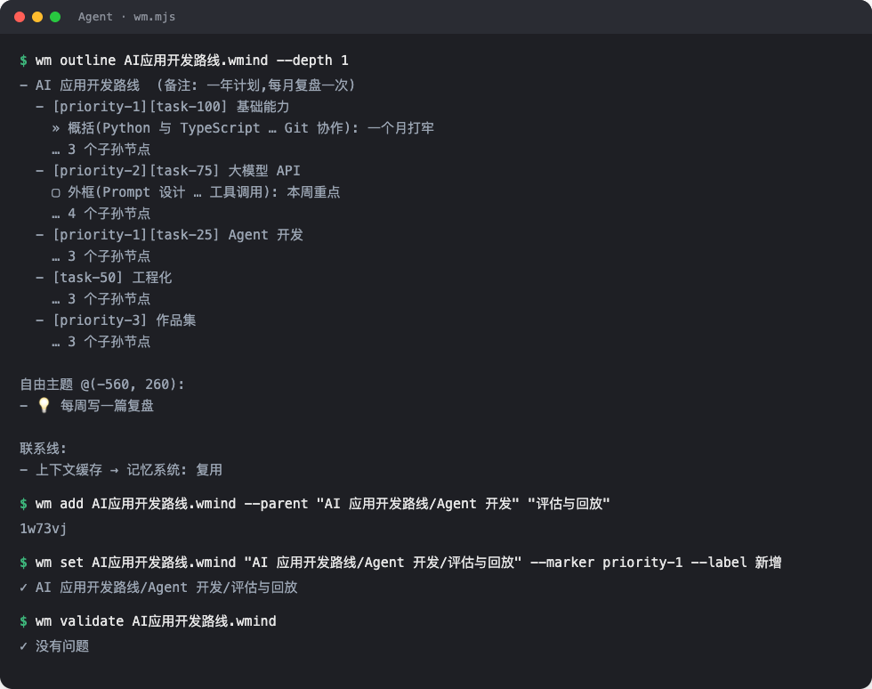

<div align="right">
  <details>
    <summary>🌐 Language</summary>
    <div>
      <div align="right">
        <p><a href="./README.md">English</a></p>
        <p><a href="./README.zh-CN.md">简体中文</a></p>
      </div>
    </div>
  </details>
</div>

<h1 align="center">
  <a href="https://github.com/Azure12355/weilanx-mind-map/releases">
    <br>
  </a>
</h1>

<p align="center"><a href="./README.md">English</a> | 中文 | <a href="https://azure12355.github.io/weilanx-mind-map/">官网</a> | <a href="#-让-ai-agent-帮你安装">For Agents</a> | <a href="#-快速开始">快速开始</a> | <a href="#-文件格式">文件格式</a> | <a href="#-给-agent-用">Agent 读写</a> | <a href="#-开发">开发</a> | <a href="https://github.com/Azure12355/weilanx-mind-map/issues">反馈</a><br></p>

<div align="center">

[![][vscode-shield]][vscode-link]
[![][obsidian-shield]][obsidian-link]
[![][typescript-shield]][typescript-link]
[![][react-shield]][react-link]
[![][i18n-shield]][i18n-link]

</div>
<div align="center">

[![][release-shield]][release-link]
[![][stars-shield]][stars-link]
[![][issues-shield]][issues-link]
[![][license-shield]][license-link]
[![][pr-shield]][pr-link]

</div>

# 🧠 Weilanx Mind Map

Weilanx Mind Map 是一款 **XMind 风格的思维导图插件**，在 **VS Code**（以及 Cursor、Windsurf）和 **Obsidian** 里都能用，两边打开的是同一个文件。

每张导图就是一个 `.wmind` 文件，内容是**普通的 JSON**，结构是嵌套树。你在画布上拖拽、编辑；AI Agent 直接读写这个文件，或者用自带的 `wm.mjs` 命令行修改。哪一边改了，另一边都会实时刷新。

❤️ 喜欢的话点个 Star 🌟，对我帮助很大！



# 🌟 主要特性

1. **XMind 的手感**：

- 🌈 彩虹分支、由粗变细的主干曲线，子主题用扇形曲线连到下划线上
- 🎨 6 套内置主题：经典、清新、商务、暗夜、手写、黑白，各自都有亮色和暗色两个版本，跟着编辑器自动切换
- 🧭 4 种结构：思维导图、逻辑图、组织结构图、树形图，既可以给整张图设，也可以只给某个分支设

2. **编辑**：

- ⌨️ 快捷键和 XMind 一样：`Enter` 加同级、`Tab` 加子级、`Shift+Tab` 加上级，`Space`/`F2` 进入编辑，选中后直接打字也行（支持中文输入法）
- 🖱 拖拽改层级和顺序，拖到空白处就变成自由主题；`Shift` 拖动框选，`⌘` 点击多选
- ↩️ 撤销 / 重做；复制粘贴整棵子树，也可以直接粘贴 Markdown 或缩进文本
- 🗒 大纲视图：把整张导图当成缩进列表来写

3. **样式与内容**：

- 🖌 右侧格式面板：形状、填充、边框、文字（字号、粗体、斜体、删除线、颜色）、分支线（颜色、粗细、曲线 / 直线 / 折线），多选后可以批量改
- 🏷 标记（优先级、任务进度、旗帜、星星、表情、符号）、标签、备注、超链接
- 🔗 联系线（拖控制点调弧度，可以加文字）、概括、外框、自由主题

4. **导入导出**：

- 🖼 导出 PNG（2 倍清晰度）、SVG、Markdown 大纲
- 📝 右键 Markdown 文件，一键转换成导图

5. **对 Agent 友好**：

- 🤖 嵌套树结构的 JSON，读一遍就能看懂整张图；只写和默认值不同的字段，新节点可以不写 `id`
- 🧾 键的顺序和缩进固定，git diff 很干净
- 🛠 自带 skill 和零依赖命令行 `wm.mjs`：输出缩进大纲（最省 token），节点可以用路径定位（如 `产品规划/MVP`），改完自动校验
- 🔄 每次编辑后立即保存；文件被外部修改时，打开着的画布实时刷新

<table>
  <tr>
    <td width="50%"></td>
    <td width="50%"></td>
  </tr>
  <tr>
    <td align="center">标记、标签、备注、概括、外框、联系线</td>
    <td align="center">跟随编辑器的暗色模式</td>
  </tr>
</table>

### 🎨 6 套主题



### 🧭 4 种结构



### 🗒 大纲视图



# 🤖 让 AI Agent 帮你安装

把下面这段话粘贴给 **Claude Code**、**Codex**、**Cursor** 或任何能用终端的 Agent：

```text
帮我安装 Weilanx Mind Map 思维导图插件和它的 Agent skill。
按照 https://github.com/Azure12355/weilanx-mind-map/blob/main/docs/install-for-agents.md 操作，
装完先校验，再告诉我结果。
```

也可以自己运行安装脚本（macOS / Linux）。它会自动找到 VS Code、Cursor、Windsurf、Insiders，逐个安装并校验：

```bash
curl -fsSL https://raw.githubusercontent.com/Azure12355/weilanx-mind-map/main/scripts/install.sh | bash
```

Obsidian 用户把库的路径传进去；想让 Agent 会用导图，再装上 skill：

```bash
curl -fsSL https://raw.githubusercontent.com/Azure12355/weilanx-mind-map/main/scripts/install.sh | bash -s -- --obsidian "/你的/库/路径"
curl -fsSL https://raw.githubusercontent.com/Azure12355/weilanx-mind-map/main/scripts/install.sh | bash -s -- --skill
```

> 只想装到某一个编辑器，就在 `bash` 前面加上 `WM_EDITOR=cursor`。给 Agent 看的完整步骤和校验方法见 [`docs/install-for-agents.md`](./docs/install-for-agents.md)。

# 🚀 快速开始

**VS Code**

1. 从最新 Release 下载 [`weilanx-mind-map.vsix`](https://github.com/Azure12355/weilanx-mind-map/releases/latest/download/weilanx-mind-map.vsix)。
2. 在扩展面板点 `···` → **从 VSIX 安装...**，或者运行 `code --install-extension weilanx-mind-map.vsix --force`。
3. 打开任意 `.wmind` 文件（可以先试试 [`examples/AI应用开发路线.wmind`](./examples/AI应用开发路线.wmind)）；也可以右键文件夹 → **创建思维导图 (.wmind)**。

**Obsidian**

1. 从[最新 Release](https://github.com/Azure12355/weilanx-mind-map/releases/latest) 下载 `main.js`、`manifest.json`、`styles.css`，放进 `<库>/.obsidian/plugins/weilanx-mind-map/`。也可以用 [BRAT](https://github.com/TfTHacker/obsidian42-brat)，填入 `Azure12355/weilanx-mind-map` 安装。
2. 在 设置 → 第三方插件 里启用 **Weilanx Mind Map**。
3. 打开 `.wmind` 文件，或者点左侧功能区的脑图图标新建；右键 Markdown 笔记可以转换成导图。在 Obsidian 里，链接还可以写成 `[[笔记名]]`。

### ⌨️ 快捷键

| 操作 | 按键 |
|---|---|
| 添加同级 / 子级 / 上级主题 | `Enter` / `Tab` / `Shift+Tab` |
| 在前面插入同级主题 | `Shift+Enter` |
| 编辑文字 | `Space`、`F2`、双击，或者选中后直接打字 |
| 编辑时换行 / 结束编辑 | `Shift+Enter` / `Enter` 或 `Esc` |
| 删除 | `Delete` / `Backspace` |
| 在主题间移动 / 和兄弟主题交换位置 | 方向键 / `⌘↑` `⌘↓` |
| 折叠 / 展开 | `⌘/` 或点击分支末端的圆点 |
| 撤销 / 重做 | `⌘Z` / `⌘⇧Z` |
| 放大 / 缩小 / 适应画布 | `⌘=` / `⌘-` / `⌘0` |
| 平移 / 缩放 | 拖动空白处、按住空格拖动 / `⌘` + 滚轮、触控板捏合 |
| 多选 / 框选 | `⌘` + 点击 / `Shift` + 拖动 |
| 新建自由主题 | 双击空白处 |

Windows / Linux 上把 `⌘` 换成 `Ctrl`。

# 📄 文件格式

一个 `.wmind` 文件就是这样一份 JSON：

```json
{
  "version": 1,
  "theme": "fresh",
  "root": {
    "id": "a1b2c3",
    "text": "产品规划",
    "children": [
      {
        "id": "k9x2m1",
        "text": "用户调研",
        "markers": ["priority-1", "task-50"],
        "summaries": [{ "id": "s1", "from": "p0q9w8", "to": "p0q9w9", "text": "两周完成" }],
        "children": [
          { "id": "p0q9w8", "text": "访谈 10 人", "labels": ["定性"] },
          { "id": "p0q9w9", "text": "问卷 500 份", "note": "Markdown 备注" }
        ]
      },
      { "id": "z7y6x5", "text": "MVP", "style": { "fill": "#FFE8A3" } }
    ]
  },
  "relationships": [{ "id": "r1", "from": "k9x2m1", "to": "z7y6x5", "text": "输入需求" }]
}
```

- **嵌套树结构**：缩进本身就是层级。
- **只写非默认值**：不写 `style` 就表示跟随主题；`collapsed` 只在为 `true` 时出现。
- **新节点可以不写 `id`**：插件打开时会自动补上。
- **概括和外框用首尾子节点的 id 表示范围**：插入兄弟节点后范围不会错位。
- **主题**：`classic` · `fresh` · `business` · `night` · `sketch` · `mono`。**结构**：`map` · `logic` · `org` · `tree`。

完整字段说明见 [references/format.md](./skills/weilanx-mind-map/references/format.md)，JSON Schema 在 [schema/wmind.schema.json](./schema/wmind.schema.json)。在 VS Code 里点编辑器右上角的 **以 JSON 文本打开**，就能用 Schema 补全和校验来手改 JSON。

# 🛠 给 Agent 用

[`skills/weilanx-mind-map`](./skills/weilanx-mind-map) 是一个现成的 skill：`SKILL.md`、格式参考，加上零依赖的命令行 `wm.mjs`（需要 Node 18+）。插件和 `wm.mjs` 用的是同一套解析和保存逻辑，写出来的文件逐字节一致。



```bash
WM="node skills/weilanx-mind-map/scripts/wm.mjs"
$WM outline 产品规划.wmind --ids                       # 缩进大纲，最省 token
$WM add 产品规划.wmind --parent "产品规划/MVP" "导出功能" "导入功能"
$WM set 产品规划.wmind "产品规划/MVP/导出功能" --marker priority-1 --style fill=#FFE8A3
$WM rel 产品规划.wmind "产品规划/用户调研" "产品规划/MVP" --text 输入需求
$WM from-md 周会纪要.md -o 周会纪要.wmind               # Markdown 大纲 → 导图
$WM validate 产品规划.wmind
```

如果插件开着这个文件，Agent 每改一次，画布就会刷新一次。

# ⚙️ 设置项

| 设置 | 默认值 | 说明 |
| --- | --- | --- |
| `wmind.autoSave`（VS Code） | `true` | 每次编辑后立即保存，Agent 读到的总是最新内容 |
| 每次编辑后立即保存（Obsidian） | 开 | 关掉后改用 Obsidian 默认的 2 秒延迟保存 |

# 🔧 开发

```bash
npm install
npm run dev:web          # 在浏览器里预览画布（用 localStorage 模拟文件）
npm test                 # core 单元测试 + wm.mjs 集成测试
npm run typecheck

npm run package          # 构建并生成 weilanx-mind-map.vsix
npm run build:obsidian   # Obsidian 插件 -> dist/obsidian/{main.js,manifest.json,styles.css}
npm run dev:obsidian -- --out "/你的/库/.obsidian/plugins/weilanx-mind-map"   # 改动后自动重新构建
```

代码结构：

| 目录 | 作用 |
|---|---|
| `src/core` | 文件格式、编辑操作、主题、布局引擎、Markdown 互转，纯 TS，各端共用 |
| `webview/src` | React 画布界面，VS Code 和 Obsidian 共用 |
| `src/vscode` · `src/obsidian` | 两个宿主外壳 |
| `src/cli` | `wm.mjs` 命令行（构建到 `skills/weilanx-mind-map/scripts/`） |

# 📝 路线图

- 📥 导入 / 导出 XMind 的 `.xmind` 文件
- 🖼 节点里插入图片
- 📑 一个文件多张画布
- 📝 在 Obsidian 笔记里用 `![[导图.wmind]]` 嵌入导图
- 🏪 上架 VS Code 插件市场和 Obsidian 社区插件市场

# 🤝 参与贡献

欢迎提 Issue 和 Pull Request！提交 PR 前请先跑通 `npm test` 和 `npm run typecheck`。

# 📜 开源协议

[MIT](./LICENSE) © Azure12355

<!-- badges -->
[vscode-shield]: https://img.shields.io/badge/VS%20Code-%5E1.90-007ACC?logo=visualstudiocode&logoColor=white
[vscode-link]: https://code.visualstudio.com/
[obsidian-shield]: https://img.shields.io/badge/Obsidian-1.5%2B-7C3AED?logo=obsidian&logoColor=white
[obsidian-link]: https://obsidian.md/
[typescript-shield]: https://img.shields.io/badge/TypeScript-5-3178C6?logo=typescript&logoColor=white
[typescript-link]: https://www.typescriptlang.org/
[react-shield]: https://img.shields.io/badge/React-19-61DAFB?logo=react&logoColor=black
[react-link]: https://react.dev/
[i18n-shield]: https://img.shields.io/badge/i18n-English%20%7C%20中文-0088CC
[i18n-link]: ./README.md
[release-shield]: https://img.shields.io/github/v/release/Azure12355/weilanx-mind-map?logo=github
[release-link]: https://github.com/Azure12355/weilanx-mind-map/releases
[stars-shield]: https://img.shields.io/github/stars/Azure12355/weilanx-mind-map?logo=github
[stars-link]: https://github.com/Azure12355/weilanx-mind-map/stargazers
[issues-shield]: https://img.shields.io/github/issues/Azure12355/weilanx-mind-map?logo=github
[issues-link]: https://github.com/Azure12355/weilanx-mind-map/issues
[license-shield]: https://img.shields.io/badge/License-MIT-green.svg
[license-link]: ./LICENSE
[pr-shield]: https://img.shields.io/badge/PRs-welcome-FF6699.svg
[pr-link]: https://github.com/Azure12355/weilanx-mind-map/pulls
